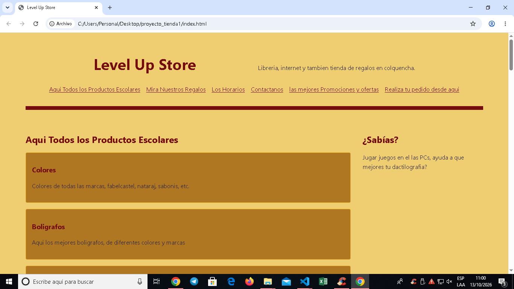

# Tienda Internet, libreria y regalos "Level Up Store"

**Estudiante:** Guido Fernandez Ajno
**Cliente:** Bragin Quispe Mamani y lucy Gladys Fernandez Ajno 
**URL publicada:** [DESPUES, PROXIMA SEMANA]

## Qué resuelve
mi cliente tiene dificultad en registrar y poner precio a todos los productos, como tambien los prodcutos nuevos, esta pagina web ayudara a organizar mejor las ventas como tambien promocionando los nuevos articulos sin que los compradores tengan que venir a ver, solo revisaran la pagina.

## Cómo está construido
- **Semántica:** en html utilizamos la etiqueta header junto con un contenedor nav y listas desordenadas (ul, li) para la barra de navegación superior. El cuerpo principal se divide de forma lógica mediante etiquetas section (para productos, regalos, promociones, horarios y pedidos) utilizando article para agrupar cada articulo individual de contenido. Asimismo, se integró un bloque figure con su respectivo figcaption para la imagen ilustrativa, un formulario de contacto estructurado con fieldset y legend, y finalmente un footer que incluye etiquetas de la parte de abajo con mostrando el copyrigt address y small para la información de contacto y el año de la tienda y por ultimo puse un ultimo div para poner el enlace de las redes sociales de la pagina.

- **Layout:** Usé Flexbox principalmente para alinear los elementos del encabezado, organice los elementos en línea de la barra de navegación y el bloque de información ¿Sabías qué?. tambien implemente CSS Grid para estructurar las tarjetas de productos, regalos y el formulario de pedidos, logrando que se adapten de forma completamente fluida a diferentes tamaños de pantalla sin salirse.

- **Diseño:** elegi una combinacion de naranja "#ecc455d3", rojo #750d0d, y amarillo #cf9b44 para transmitir una calidez y alegria para que los usuarios que seran los estudiantes puedan sentirse comodos, revisando la pagina, se utilizo una tipografia legible como el Segoe porque es una fuente legible, y el color facilita la visibilidad y lectura. 

## Capturas

 DESPUES, PROXIMA SEMANA

## Lo más difícil
lo mas dificil de hacer fue mostrar las secciones de prodcutos de forma ordenada y alienada a la pagina como para celular y computadora, tambien fue dificil ajustar la cabecera para que se muestre de forma mas llamativa, entonces con ayuda del Flexbox se pudo ajustar la la cabecera y tambien usando grit se pudo ordenar los productos en columnas adaptadas al tamaño disponible, todo eso tambien con media query para que se ajuste tanto a celulares y computadoras.

## Cambios de interfaz (octubre de 2026)
- Tema claro con fondos blancos y grises suaves; tema oscuro actualizado con superficies grafito y acentos azules/violetas.
- Acceso rápido al cambio de tema en la cabecera y enlace a Preferencias.
- Catálogo principal inicia mostrando categorías; al seleccionar una categoría se despliegan sus productos.
- El orden elegido en Preferencias ahora ordena los productos visibles.
- Coordenadas de referencia del local actualizadas a Colquencha: latitud -16.9388, longitud -68.2435.
- Retirado el mensaje promocional de disponibilidad de bolígrafos de la cabecera.
- Se conservaron los archivos de catálogo remoto `remoto.js` y `jquery-3.7.1.min.js` sin modificar su lógica.
<<<<<<< HEAD

## LABORATORIO 2 Y 3

**Laboratorio 2:** Se implementó la lógica e interactividad del catálogo de "Level Up Store" mediante JavaScript y manipulación del DOM (`app.js`, `funciones.js`, `datos.js`, `render.js` y `eventos.js`), estructurando el inventario real en categorías (Escolares, Regalos, Cosméticos e Internet) para renderizar dinámicamente las tarjetas de productos con sus precios, imágenes y estado de stock. Además, se integró un buscador en tiempo real, filtros por categoría con delegación de eventos, validación de fechas y envío de pedidos hacia WhatsApp, complementado con componentes interactivos en jQuery (`jquery-panel.js`) para el menú móvil desplegable, acordeón de preguntas frecuentes y avisos animados.

**Laboratorio 3:** Se añadieron funcionalidades avanzadas del navegador e integración asíncrona, incluyendo la carga remota del catálogo desde `datos.json` mediante `fetch` (`async/await`) y `$.getJSON` con control de estados de carga y error (`remoto.js`), así como el guardado de preferencias de usuario (modo claro/oscuro y criterio de ordenamiento) en `localStorage` junto con el cálculo de distancia hacia la tienda en Colquencha usando la API de Geolocalización (`preferencias.js`). Finalmente, se incorporó una bandeja interactiva de compras con soporte Drag & Drop y táctil (`tablero.js`), donde el cliente puede arrastrar productos desde una barra deslizable con fotos hacia su carrito para armar pedidos de varios artículos, visualizando el resumen de unidades y montos en tiempo real mediante un gráfico en `Canvas`.

=======
>>>>>>> 1e09e9ed809604cd531be51391b2dba9c0db9d8e
